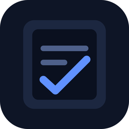
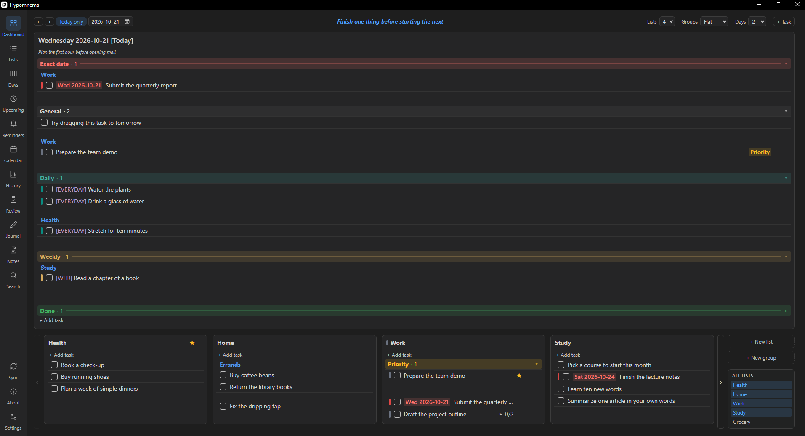
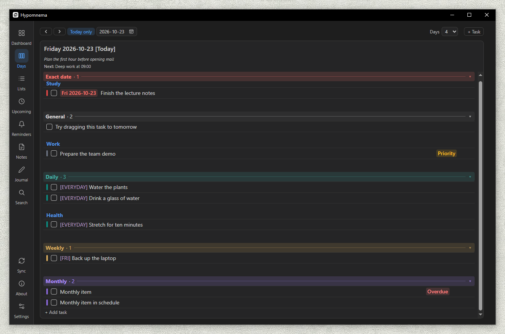
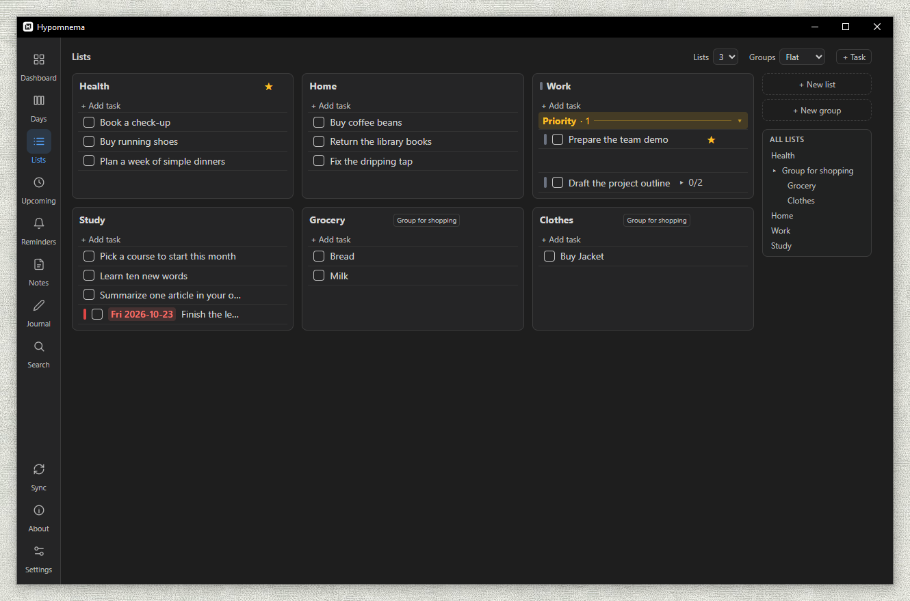
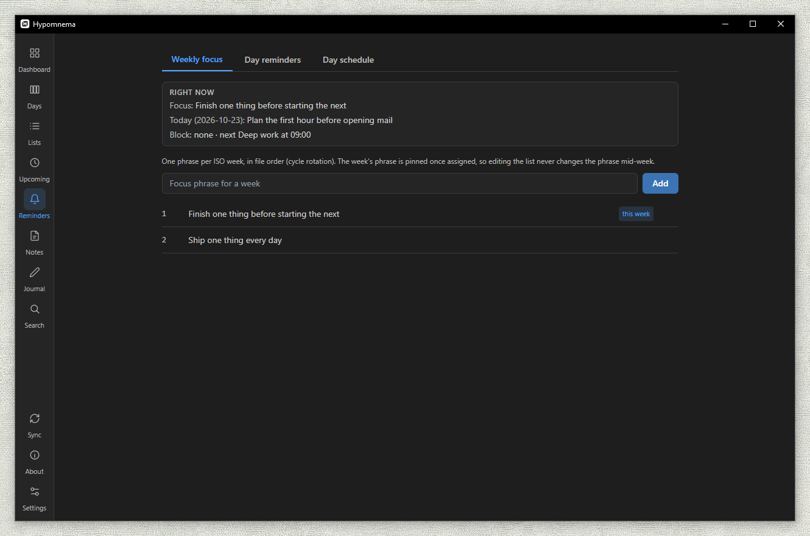
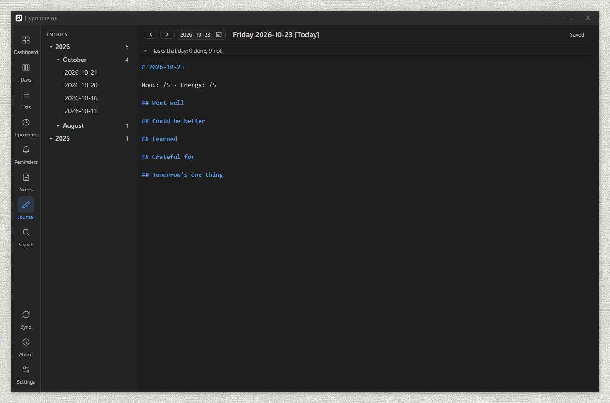
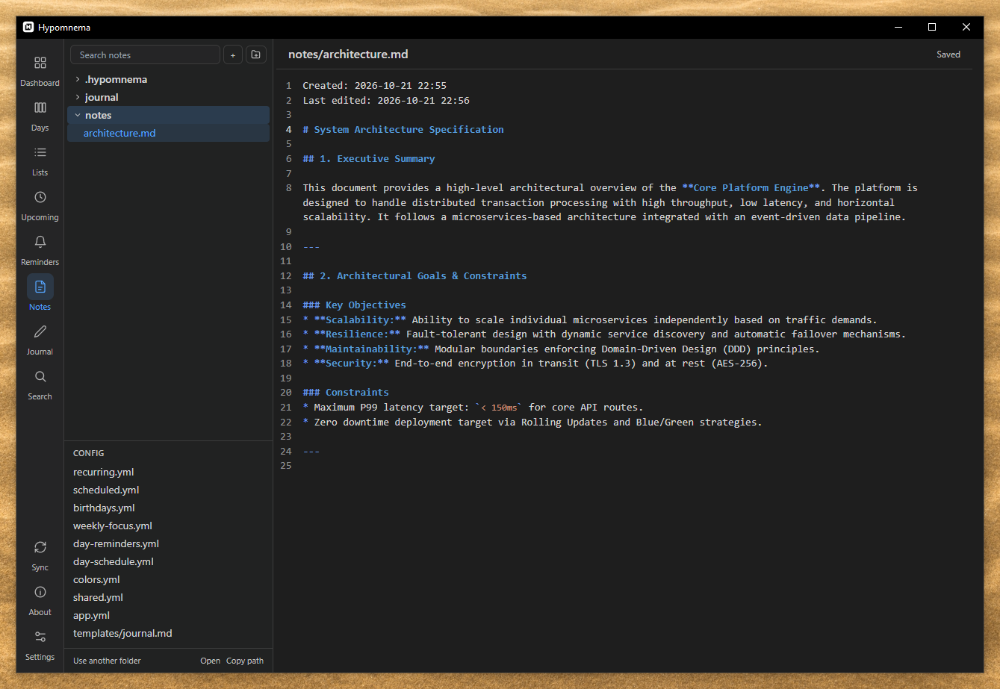
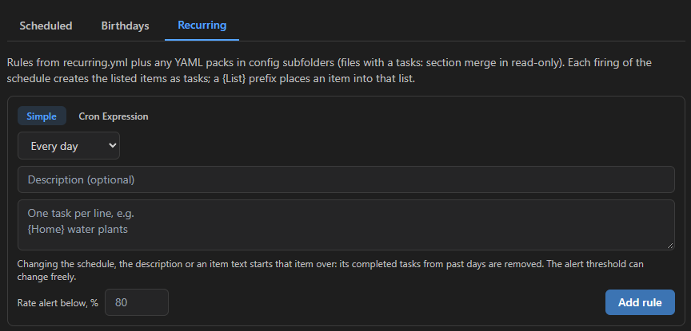

<h1 align="center">
  <br>
  Hypomnema<br>
  <sup><sub>YOUR MIND. ORGANIZED.</sub></sup>
</h1>

<p align="center">A To-Do and task planner with timeline view, custom lists, daily journal, and markdown knowledge base in one local-first window.</p>

<p align="center">
  <a href="https://github.com/publius-github/hypomnema/releases/latest"></a>
  <a href="https://github.com/publius-github/hypomnema/releases"></a>
  <a href="https://github.com/publius-github/hypomnema/actions/workflows/ci.yml"></a>
  <a href="https://publius-github.github.io/hypomnema/privacy.html"></a>
  <a href="LICENSE"></a>
</p>

<p align="center">
  <picture>
    <source media="(prefers-color-scheme: light)" srcset="docs/screenshots/dashboard-light.png">
    
  </picture>
  <br>
  <em>The Dashboard: a week of days on top, your backlog lists below. Dark or light theme, each with its own color scheme.</em>
</p>

Hypomnema keeps a week of tasks, a journal and your notes together, and keeps all of it in a folder you choose: plain Markdown and YAML files plus a local database. There is no account, no server and no telemetry. Repeating tasks, dated events and birthdays come from rules in YAML files; the app's forms and a text editor write the same files, and the engine that turns rules into tasks never duplicates one or overwrites an edit. Syncing between your devices is optional and goes through a hidden app folder in your own Google Drive.

*Hypomnema* (Greek ὑπόμνημα) was the notebook the ancient Greeks kept at hand: notes, reminders and reflections collected for one's own use. It runs on Windows 10/11 and Android, on the same vault.

> Hypomnema is free and has no ads, accounts or paid tiers. If it is useful to you, you can [support its development](https://ko-fi.com/hypomnema). <a href="https://ko-fi.com/hypomnema"></a>

## Install

### Windows

Download `Hypomnema_<version>_x64-setup.exe` from the [latest release](https://github.com/publius-github/hypomnema/releases/latest) and run it. It installs for the current user, without administrator rights; on a Windows 10 without WebView2 it downloads that first, so it needs a connection. The installer is not code-signed yet, so Windows SmartScreen may show "Windows protected your PC": choose *More info* > *Run anyway*. The app then updates itself; every update is verified against the project's signing key before it is installed.

### Android

Download `Hypomnema_<version>_arm64.apk` from the same [release](https://github.com/publius-github/hypomnema/releases/latest) on the phone and open it; Android asks once to allow installs from the browser or file manager that opened it. It needs Android 7.0 or later on a 64-bit ARM phone (nearly every phone from the last several years). The app is not on Google Play and does not update itself: to update, install the next release's APK over the installed one, which keeps the app's data. Every APK is signed with the project's key (SHA-256 `96:64:14:D2:7E:B9:51:BE:10:EC:FC:11:7D:09:30:B4:C4:3F:2A:E8:53:5B:33:89:38:25:AB:CF:29:C2:B1:91`), and Android refuses an update signed with any other.

The default vault lives in the app's own folder, which Android deletes with the app. To keep it in an ordinary folder instead (one a backup or another app can see), use Settings > Vault > *Move to another folder*; the folder browser's *Allow access* opens Android's *All files access* switch for the app. *Save a copy to Downloads* on the same page copies the vault to `Download/Hypomnema/`.

<!-- Phone screenshots. Drop these files into docs/screenshots/ and remove the
     two comment markers around the block below:
       android-day.png    - the Day screen with today's tasks
       android-lists.png  - the lists screen
       android-widget.png - the home screen with the Hypomnema widgets
     Portrait phone captures, demo data only.
<p align="center">
  
  
  
</p>
-->

To check that a download came out of this repository's release workflow, see [Code signing policy](#code-signing-policy).

### First start

On first start the app asks for a vault folder: pick an empty folder for a fresh start, or an existing folder of Markdown notes to work with them in place. A new vault starts with a few lists, tasks and rules of each kind, all meant to be edited or deleted. *Try it with an example* fills an empty folder with those plus a welcome note and a journal entry to look around in first.

Uninstalling on Windows (*Apps & features*) removes the program; your vault folder is never touched. The uninstaller's optional "Delete the application data" box clears only the per-device files under `%APPDATA%\com.hypomnema.app` (the remembered vault path, the Google sign-in, the diagnostic log).

macOS, Linux and iOS are not released and not tested. The core is cross-platform Tauri, so `npm run app:dev` should run, but the tray, quick-capture window and installer flow are Windows-only for now.

## What it does

A vertical rail on the left holds the sections; their order is configurable and Settings always sits at the bottom. The rail also holds global search (Ctrl/Cmd+K), Sync (runs the task engine and, when a Google account is signed in, a Drive sync pass) and About. On Windows there is also a tray icon and a global shortcut for a quick-capture window.

**Dashboard** is a grid of days on top (column count configurable, paged scrolling) and your own backlog lists below. Drag and drop between days and lists, subtasks, colors, times, priority, Markdown in descriptions, statuses To Do / Done / Postponed / Waiting / Dropped. The header shows the week's focus phrase and day-type reminders. **Lists** and **Days** are focused variants of the same view.

<p align="center">
  
  
  <br>
  <em>Days and Lists: the two halves of the Dashboard, each full size.</em>
</p>

**Upcoming** has three tabs: Scheduled (one-off dated events), Birthdays (with age when the year is known) and Recurring (cron rules). **Reminders** edits the three files behind the day columns: the weekly focus phrase, the reminders by day type and the daily schedule. **Calendar** is a month grid with real tasks plus projections of future rule occurrences (the horizon is configurable per cadence). **Review** and **History** show how the week went, and a month-by-month archive with completion stats and streaks for daily rules.

**Journal** keeps one Markdown entry per date (`journal/<year>/<YYYY-MM-DD>.md`), created from a configurable template on first save, with "on this day" entries from earlier years.

<p align="center">
  
  
  <br>
  <em>Reminders: the week's focus, today's reminder and the next block. Journal: one entry per day, from a template.</em>
</p>

**Notes** is the knowledge base: a tree of Markdown files (the vault root or a folder set in Settings), an editor with live highlighting, `[[wiki links]]` and backlinks, full-text search, a `.trash` folder (emptied after 30 days) and a `.hypomnemaignore` file to hide paths from the tree. The config files are edited here too, validated on save.

<p align="center">
  
  <br>
  <em>Notes: Markdown files in place, wiki links and backlinks.</em>
</p>

**Settings** has six tabs (General, Tasks, Recurring & calendar, Capture & alerts, Data, Sync) with a search over every setting. They are stored in `.hypomnema/settings/app.yml` (per device), except the task rules every device must share, which go to the synced `.hypomnema/config/shared.yml`, and the Tasks tab, which goes to the synced `.hypomnema/config/cards.yml` unless Sync task card settings is off on that device. The color scheme (`config/colors.yml`) and fine-tuning without a Settings control are edited in Notes > Config, validated on save.

## Files and forms: two ways to the same rules

Every rule the engine works from is a YAML file in `.hypomnema/config/`: `recurring.yml`, `scheduled.yml`, `birthdays.yml`, `weekly-focus.yml`, `day-reminders.yml`, `day-schedule.yml`. The app has a form for each (Upcoming and Reminders), and the form writes to the file: it rewrites only the item you changed, so the comments, the order and the blank lines you keep there survive. Open the same file in any editor or in Notes > Config, and a watcher picks the change up at once. A broken file never touches your data: the last valid version stays in effect and a banner names the file and the line.

<p align="center">
  
  <br>
  <em>Upcoming: the rules of recurring.yml as a form; the file is the source, the form is a view of it.</em>
</p>

```yaml
# recurring.yml
tasks:
  - schedule: "0 0 1 * *"        # cron
    description: "Monthly"
    items:
      - "{05 Finance} pay bills for apartment"   # {List} task text
```

The engine runs at startup, on Sync, when the day changes and when a config file changes. It remembers every rule and period it has already generated, so a restart or an edit never repeats a task, and it only adds what is missing: your edits and statuses stay. Subfolders of `config/` work as packs, any `*.yml` in them is merged in. The config files sync between devices with the rest of the vault. Manual tasks get the same treatment when the Markdown mirror is on (Settings > Data): one file per list under `.hypomnema/tasks/`, editable in bulk, imported back. The full file reference and the engine rules are in [CONFIG.md](docs/general/CONFIG.md).

## Documentation

- [Using Hypomnema](docs/general/USAGE.md) - keyboard shortcuts, sync, troubleshooting.
- [Vault, configuration and engine rules](docs/general/CONFIG.md) - the vault layout, every config file, how recurring tasks are generated.
- [Architecture](docs/general/ARCHITECTURE.md) and [Windows specifics](docs/windows/ARCHITECTURE.md) - the technical map.
- [Changelog](CHANGELOG.md), [Contributing](docs/CONTRIBUTING.md) (setup, build, release), [Security](docs/SECURITY.md).

## Status

Pre-1.0: development builds, released often (see the [changelog](CHANGELOG.md)). Windows 10/11 and Android are the shipped platforms; the Android app is built from the same project ([docs/android](docs/android/ARCHITECTURE.md)) and published as an APK on the releases page, not on Google Play. One maintainer; issues and pull requests are reviewed as time allows, with no roadmap or support commitment beyond [SECURITY.md](docs/SECURITY.md).

## Code signing policy

<!-- TODO(owner): once SignPath Foundation approves the project, uncomment:
Free code signing provided by [SignPath.io](https://about.signpath.io), certificate by [SignPath Foundation](https://signpath.org).
-->

Windows installers and Android APKs are built only by the `release.yml` GitHub Actions workflow from a tagged commit of this repository; nothing built on a personal machine is published. CI builds them, signs the Windows update artifacts with the project's updater key (the installer itself is not code-signed yet) and the APK with the project's Android key, records a [build provenance attestation](https://docs.github.com/en/actions/security-for-github-actions/using-artifact-attestations) for the installer and the APK and attaches the files to a draft release; a draft reaches users only once it is reviewed and published by hand. `gh attestation verify <file> --repo publius-github/hypomnema` checks a download against that attestation; `apksigner verify --print-certs <apk>` shows the APK's signing certificate, whose SHA-256 is the one under [Android](#android).

Team roles:

- Committers and reviewers: [@publius-github](https://github.com/publius-github)
- Approvers: [@publius-github](https://github.com/publius-github)

## Privacy

This program does not transfer any information to other networked systems unless the user asks it to: Google Drive sync runs only after the user signs in. The one exception is the update check at startup, which downloads a version file from GitHub, sends no personal data or app content, and can be turned off in Settings > General > Updates. Details in the [privacy policy](https://publius-github.github.io/hypomnema/privacy.html).

## License

Copyright (C) 2026 Siarhei Zverau

Hypomnema is free software under the GNU General Public License, version 3 only, with an additional permission under section 7 for linking with Google Play services ([LICENSE-EXCEPTION.md](LICENSE-EXCEPTION.md)). See [LICENSE](LICENSE) for the full text and [THIRD_PARTY_LICENSES.txt](THIRD_PARTY_LICENSES.txt) for the libraries it is built on. The name and logo are not covered by the GPL, and a few third-party marks are used under their own terms: see [TRADEMARKS.md](docs/TRADEMARKS.md).
